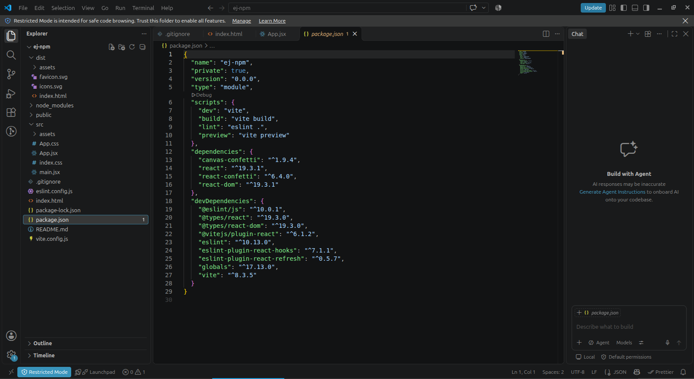
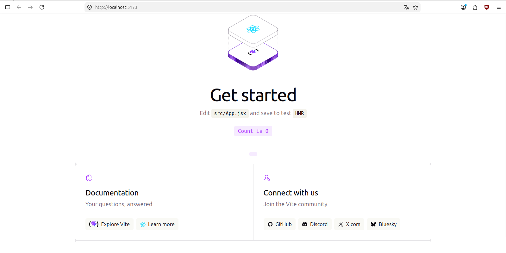
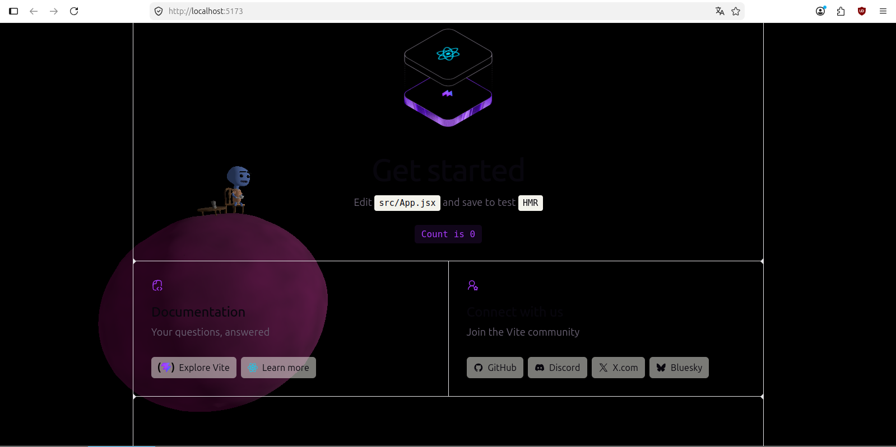

### Primera captura (Primer Commit)

### Segunda captura (package.json)

### Tercera captura (segundo commit)

### Cuarta captura (tercer commit)

### Repuesta a la pregunta

Sí, borrar una dependencia con npm uninstall (o npm remove) sí realiza una acción importante sobre el repositorio, a pesar de que la carpeta node_modules/ esté excluida (generalmente mediante el archivo .gitignore).

### Link de la web